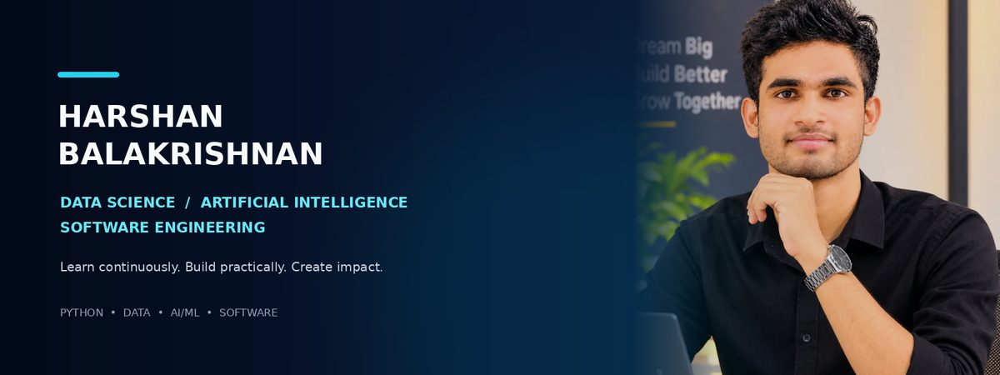

<!--
  HARSHAN BALAKRISHNAN | GitHub Profile
  Focus: Data Science • Artificial Intelligence • Software Engineering
-->

<div align="center">

  

  

  <br/>

  <a href="https://github.com/Harshan-Balakrishnan">
    
  </a>
  <a href="https://github.com/Harshan-Balakrishnan?tab=followers">
    
  </a>
  <a href="https://github.com/Harshan-Balakrishnan?tab=repositories">
    
  </a>

</div>

---

## 👨‍💻 About Me

```python
class HarshanBalakrishnan:

    def __init__(self):
        self.name = "Harshan Balakrishnan"
        self.role = "Aspiring Data Scientist & Software Engineer"
        self.education = "HND in Software Engineering & Computing"
        self.institution = "ICBT Campus, Sri Lanka"
        self.interests = [
            "Data Science",
            "Artificial Intelligence",
            "Machine Learning",
            "Software Engineering",
            "Problem Solving"
        ]

    def current_focus(self):
        return [
            "Learning Python",
            "Exploring Data Analysis",
            "Understanding Statistics",
            "Building Real-World Projects",
            "Developing Problem-Solving Skills"
        ]

    def philosophy(self):
        return "Learn continuously. Build practically. Create impact."


me = HarshanBalakrishnan()
```

I'm interested in the intersection of **Data Science, Artificial Intelligence and Software Engineering**. I'm currently strengthening my programming foundations, learning how to work with data, and building practical software projects.

My approach is simple: learn the fundamentals, apply them in real projects, and improve through feedback.

## 🎯 Current Focus

<table>
  <tr>
    <td width="50%" valign="top">

### 📊 Data Science
- Python fundamentals
- Data analysis and visualisation
- Statistics and mathematics
- SQL and data handling

    </td>
    <td width="50%" valign="top">

### 🤖 AI & Machine Learning
- Understanding AI concepts
- Machine learning foundations
- Data-driven applications
- Exploring intelligent automation

    </td>
  </tr>
  <tr>
    <td width="50%" valign="top">

### 💻 Software Engineering
- Java and C#
- Object-oriented programming
- Web application development
- Database design

    </td>
    <td width="50%" valign="top">

### 🧠 Core Skills
- Problem solving
- Data structures and algorithms
- Git and GitHub
- Project documentation

    </td>
  </tr>
</table>

## 🛠️ Technology & Tools

**Programming and Web**

<p>
  
</p>

**Databases and Development Tools**

<p>
  
</p>

**Currently learning**

<p>
  
  
  
  
</p>

## 🚀 Selected Projects

A selection of projects that show how I'm applying software development and data skills to practical problems.

<table>
  <tr>
    <td width="50%" valign="top">
      <a href="https://github.com/Harshan-Balakrishnan/lanka-lottery-voice">
        
      </a>
      <h3>🇱🇰 Lanka Lottery Voice</h3>
      <p>A photo-first, voice-friendly multilingual prototype concept for helping people navigate Sri Lankan lottery-ticket information in Tamil, Sinhala and English.</p>
      <p><strong>Tech:</strong> TypeScript · JavaScript · PWA</p>
      <p><strong>Status:</strong> Prototype — not production-ready. No live official results integration or verified prize engine yet.</p>
      <a href="https://github.com/Harshan-Balakrishnan/lanka-lottery-voice">Explore repository →</a>
    </td>
    <td width="50%" valign="top">
      <a href="https://github.com/Harshan-Balakrishnan/Sales-Data-Analysis-project-using-Python">
        
      </a>
      <h3>📊 Sales Data Analysis</h3>
      <p>Exploring retail sales, profit, categories and regional performance using a sample Superstore dataset.</p>
      <p><strong>Tech:</strong> Python · Pandas · Matplotlib · Seaborn · Jupyter</p>
      <p><strong>Focus:</strong> Data cleaning, aggregation, visualisation and communicating business insights.</p>
      <a href="https://github.com/Harshan-Balakrishnan/Sales-Data-Analysis-project-using-Python">Explore notebook & analysis →</a>
    </td>
  </tr>
  <tr>
    <td width="50%" valign="top">
      <a href="https://github.com/Harshan-Balakrishnan/ai-fintech-dashboard">
        
      </a>
      <h3>💳 AI Fintech Dashboard</h3>
      <p>A front-end financial dashboard concept with an improved layout, navigation, sidebar and interactive interface elements.</p>
      <p><strong>Tech:</strong> HTML · Tailwind CSS · JavaScript</p>
      <p><strong>Status:</strong> Front-end concept; not presented as a production AI or financial service.</p>
      <a href="https://github.com/Harshan-Balakrishnan/ai-fintech-dashboard">Explore repository →</a>
    </td>
    <td width="50%" valign="top">
      <a href="https://github.com/Harshan-Balakrishnan/Janushan-Ice-Cream-Van-Manager">
        
      </a>
      <h3>🍦 Janushan Ice Cream Van Manager</h3>
      <p>A mobile-first installable business PWA concept for multilingual van operations, product catalogue, sales, stock, expenses and reconciliation.</p>
      <p><strong>Tech:</strong> JavaScript · PWA · Supabase</p>
      <p><strong>Focus:</strong> Practical workflow design, role-based access and offline-aware operations.</p>
      <a href="https://github.com/Harshan-Balakrishnan/Janushan-Ice-Cream-Van-Manager">Explore repository →</a>
    </td>
  </tr>
</table>

### 🎓 TriClarity — HND Computing Project

A project in development exploring PDF accessibility and multilingual Unicode compliance for public-service documents, with a focus on Sinhala, Tamil and English.

**Planned areas:** document inspection, accessibility checks, language and Unicode readiness, and structured audit reports.

*Status: Project planning / development. This is not yet presented as a completed or released product.*

### More experiments

- [Loom Aura — front-end fashion e-commerce demo](https://github.com/Harshan-Balakrishnan/Loom-Aura)
- [Personal Portfolio — website source](https://github.com/Harshan-Balakrishnan/Personal_Portfolio)

> Project descriptions reflect the current repository documentation. Prototypes and concepts are labelled clearly; they should not be mistaken for production services.

---

## 📈 GitHub Overview

<div align="center">
  
  
  <br/>
  
</div>

## 🐍 Contribution Snake

<div align="center">

  <a href="https://github.com/Harshan-Balakrishnan/Harshan-Balakrishnan/actions/workflows/snake.yml">
    
  </a>

  <picture>
    <source media="(prefers-color-scheme: dark)" srcset="https://raw.githubusercontent.com/Harshan-Balakrishnan/Harshan-Balakrishnan/output/github-contribution-grid-snake-dark.svg" />
    <source media="(prefers-color-scheme: light)" srcset="https://raw.githubusercontent.com/Harshan-Balakrishnan/Harshan-Balakrishnan/output/github-contribution-grid-snake.svg" />
    
  </picture>

</div>

## 📊 Contribution Activity

<div align="center">
  
</div>

---

## 🌱 My Philosophy

<div align="center">

### “Learn continuously. Build practically. Create impact.”

**Think · Learn · Build · Improve · Repeat**

</div>

## 🤝 Connect With Me

<div align="center">
  <a href="https://github.com/Harshan-Balakrishnan">
    
  </a>
  <a href="https://www.linkedin.com/in/harshan-balakrishnan-770310369/">
    
  </a>
</div>

<div align="center">
  <br/>
  <sub>Thanks for visiting. Feel free to explore my repositories and follow my learning journey.</sub>
  <br/><br/>
  
</div>
